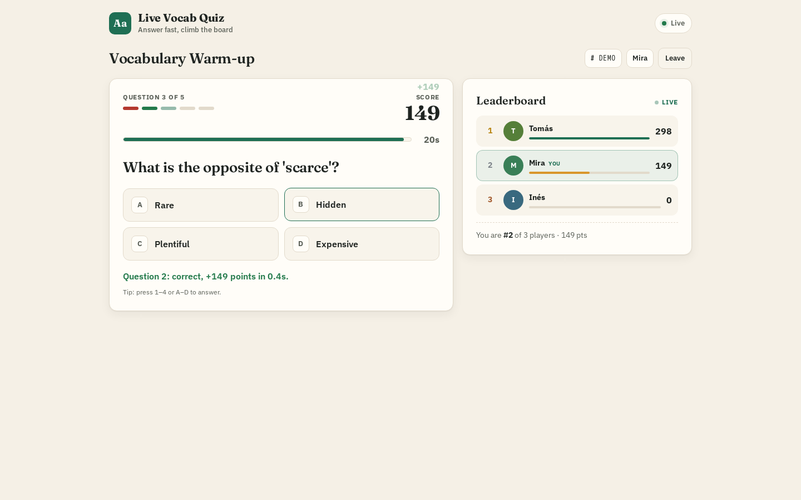
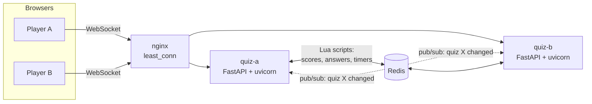
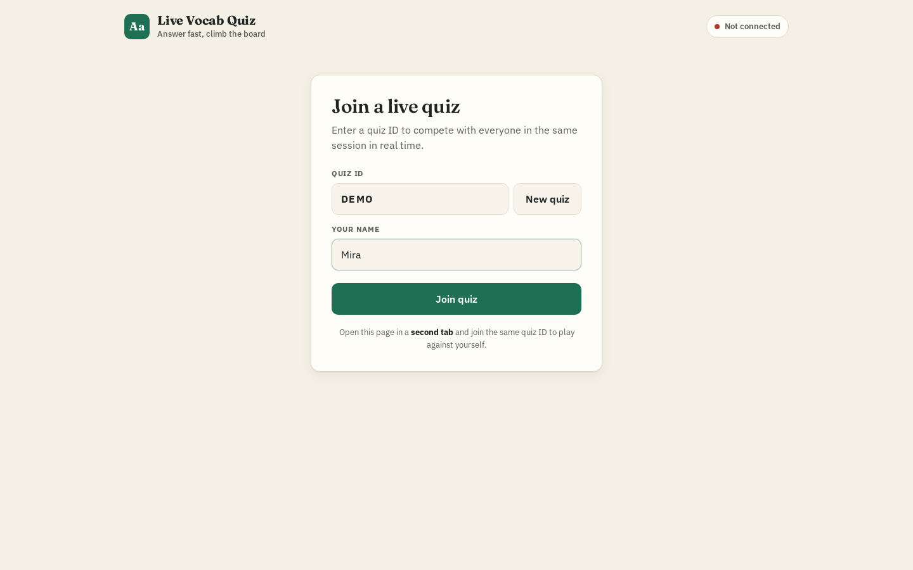
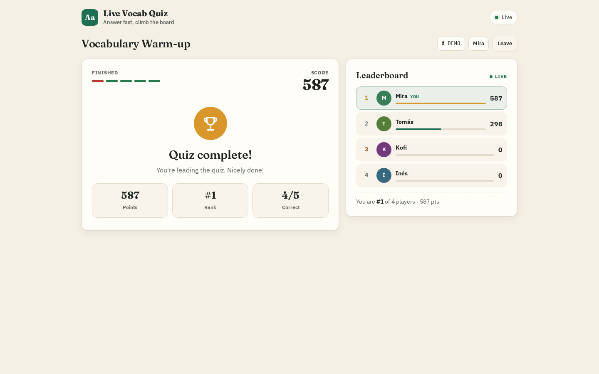
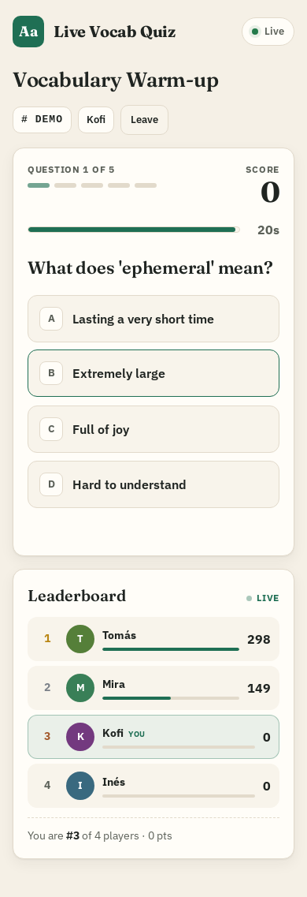
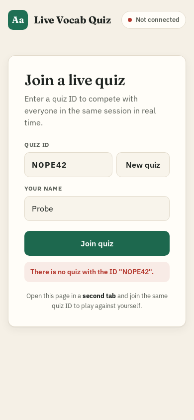

# Real-Time Vocabulary Quiz

A real-time quiz server for an English learning app. Players join a quiz by ID, answer vocabulary questions against a server-side timer, and watch a live leaderboard update as everyone else answers. The server decides the score, and the same quiz can be served from several stateless nodes that share one Redis.



- **System design:** [docs/DESIGN.md](docs/DESIGN.md) covers the architecture, data flow, technology choices, scalability, reliability and observability.
- **Test results:** [docs/TEST_RESULTS.md](docs/TEST_RESULTS.md) holds the raw output of the tests, the mutation check and the load tests, with dates.
- **Requirements traceability:** [docs/REQUIREMENTS.md](docs/REQUIREMENTS.md) maps every requirement in the brief to its code and evidence.
- **AI collaboration log:** [docs/AI_COLLABORATION.md](docs/AI_COLLABORATION.md) records what the AI wrote, how it was prompted, and how each part was verified.

## What it does

| Acceptance criterion | How it is met | Proven by |
|---|---|---|
| Join a quiz by unique ID | `ws://…/ws/quizzes/{quiz_id}`. Unknown IDs close with 4404. `POST /api/quizzes` creates a session with a random ID that every node can resolve. | `test_ws.py`, `test_multinode.py` |
| Many users in one quiz | Per-quiz connection registry. State lives in a shared store, so players of one quiz can be on different nodes. | `test_ws.py`, `test_multinode.py`, Compose load test |
| Real-time score updates | The server scores each answer and pushes `answer_result` with the new total immediately. | `test_ws.py` scoring tests |
| Accurate, consistent scoring | Server-side timer and scoring. One atomic operation does "dedupe, add points, bump version", so retries and races never double-count. | `test_store_contract.py`: 50 concurrent duplicates count once, on memory, fakeredis and real Redis |
| Live leaderboard | Each node pushes the top 10 plus the player's own rank, coalesced to at most one push per quiz every 100 ms. | `test_hub.py`, load tests |

Mocked: authentication (`user_id` comes from the query string), quiz content (one in-memory demo quiz, `DEMO`, reused for created sessions), and the web client (a single HTML page served at `/`).

## How it fits together



An answer goes through `QuizService` to the store, where one Lua script checks for a duplicate, adds the points and bumps the quiz version. The node then publishes "quiz changed" on the bus. Every node with players in that quiz marks it dirty, and its `Hub` sends one leaderboard snapshot per dirty quiz per 100 ms window. Only the notification crosses the bus. Scores are always read from the store, so a lost notification is repaired by the next one, or by the hub's 5-second resync.

With `QUIZ_STORE=memory` (the default) the same code runs as a single process with no Redis.

## Running it

### Two nodes, nginx and Redis (Docker Compose)

```bash
docker compose up --build        # http://localhost:8080
```

Set `QUIZ_HTTP_PORT=9090` to use a different host port. Compose waits until Redis answers `PING` and both nodes pass `/healthz` before nginx starts. Open http://localhost:8080 in two browser windows, join quiz `DEMO` under different names, and answer. Each window's leaderboard updates live, even when nginx sends the two windows to different nodes. Stop with `docker compose down -v`.

### Single process (Python 3.12)

```bash
make install      # creates .venv and installs requirements-dev.txt
make test         # 58 tests and 1 skip, about 2 s
make lint         # ruff
make mutation     # breaks 8 critical behaviours and checks the tests catch each one, about 1 min
make run          # http://localhost:8000, in-memory store
make load-test    # in a second terminal while `make run` is running
```

`make run` reads `.env` if it exists. [.env.example](.env.example) lists every setting with its default. To use Redis from a single process, run `make run-redis` with Redis on `localhost:6379`.

To run the store contract suite against a real Redis as well as the in-memory store and fakeredis, point it at a database it may flush:

```bash
QUIZ_TEST_REDIS_URL=redis://localhost:6379/15 make test   # 69 tests and 1 skip
```

## Using it

| | |
|---|---|
|  |  |
|  |  |

The client keeps one player identity per browser tab. Refreshing a tab resumes the same player, and a new tab is a new player. After a dropped connection it reconnects with back-off and jitter, and the server restores the score and the current question. The question timer keeps running while the player is disconnected. Answers work by click or with the keys 1–4 or A–D.

### REST

Captured from the Compose stack:

```http
POST /api/quizzes
Content-Type: application/json

{"title": "Friday vocab"}
```
```json
201 Created
{"quiz_id": "SOZQL4OB", "title": "Friday vocab", "question_count": 5}
```

```http
GET /api/quizzes/NOPE/leaderboard
```
```json
404 Not Found
{"detail": "quiz not found"}
```

Other endpoints: `GET /api/quizzes/{id}/leaderboard?top=10` (REST fallback for the live board), `/healthz` (liveness), `/readyz` (returns 503 when the store is unreachable), `/metrics` (Prometheus).

### WebSocket protocol

`ws://localhost:8080/ws/quizzes/DEMO?user_id=alice&name=Alice`. The trace below was captured through nginx with a second player, Bob, connected. Messages are trimmed to the fields that matter.

```text
<- {"type":"joined","quiz":{"id":"DEMO","title":"Vocabulary Warm-up","question_count":5},
    "me":{"user_id":"alice","name":"Alice","score":0,"answered":0},"rejoined":false}
<- {"type":"leaderboard","version":2,"total_participants":2,
    "top":[{"rank":1,"user_id":"alice","name":"Alice","score":0},{"rank":2,"user_id":"bob","name":"Bob","score":0}],
    "me":{"rank":1,"score":0}}
<- {"type":"question","index":0,"total":5,"time_remaining_s":20.0,
    "question":{"id":"q1","prompt":"What does 'ephemeral' mean?",
                "options":["Lasting a very short time","Extremely large","Full of joy","Hard to understand"],"time_limit_s":20.0}}
-> {"type":"answer","question_id":"q1","choice":0,"request_id":"r1"}
<- {"type":"answer_result","request_id":"r1","question_id":"q1","correct":true,"correct_index":0,
    "points_awarded":150,"score":150,"elapsed_s":0.001,"version":3}
<- {"type":"question","index":1,"total":5,"question":{"id":"q2",...},"time_remaining_s":20.0}
<- {"type":"leaderboard","version":3,"top":[{"rank":1,"user_id":"alice","name":"Alice","score":150},...],"me":{"rank":1,"score":150}}
-> {"type":"answer","question_id":"q1","choice":0,"request_id":"r1"}
<- {"type":"error","code":"already_answered","message":"You already answered this question","question_id":"q1","score":150,"request_id":"r1"}
```

A correct answer scores 100 points plus a speed bonus of up to 50. The bonus falls linearly to 0 at the time limit and is measured from when the server first sent the question. Wrong or late answers score 0. A client sends `"choice": null` when its timer runs out. The question never includes `correct_index`. Error codes and close codes are listed in [docs/DESIGN.md](docs/DESIGN.md).

## Design choices worth knowing

- **The server is authoritative.** Clients send only a choice. Correctness, elapsed time and points are decided on the server, and the first-served time is stored, so reconnecting cannot restart the timer.
- **One atomic write per answer.** Both stores implement "reject duplicate, add points, bump version" as one step: a Lua script in Redis, and code with no `await` in the in-memory store. One contract suite runs against memory, fakeredis and, when configured, real Redis.
- **Coalesced fan-out.** Pushing a leaderboard on every answer is O(N²) messages. The hub sends at most one snapshot per quiz every 100 ms, builds the shared part of the JSON once, and appends each player's own rank.
- **Slow clients cannot stall others.** Each socket has its own writer task. Important messages go through a bounded queue, and leaderboards use a single "latest wins" slot. A client that falls too far behind is closed with 1013 and resumes when it reconnects.
- **Versioned snapshots.** Every leaderboard carries the quiz version, and `answer_result` reports the version that includes the answer. Clients drop out-of-order snapshots.
- **Redis keys share a hash tag.** Every key of a quiz is under `quiz:{id}:…`, so a Redis Cluster keeps them in one slot. Every key has a TTL that player activity refreshes.

## Configuration

Environment variables, read in `quiz_server/config.py`:

| Variable | Default | Meaning |
|---|---|---|
| `QUIZ_STORE` | `memory` | `memory` or `redis`. Any other value fails at startup. |
| `QUIZ_REDIS_URL` | `redis://localhost:6379/0` | Redis connection |
| `QUIZ_REDIS_MAX_CONNECTIONS` | `100` | Per-node pool size. Callers wait for a free connection rather than fail. |
| `QUIZ_LEADERBOARD_INTERVAL_S` | `0.1` | Coalescing window |
| `QUIZ_LEADERBOARD_TOP_N` | `10` | Leaderboard size pushed to clients |
| `QUIZ_SEND_QUEUE_SIZE` | `64` | Per-connection queue before a slow client is disconnected |
| `QUIZ_RATE_LIMIT_PER_S` / `QUIZ_RATE_LIMIT_BURST` | `10` / `20` | Per-connection token bucket |
| `QUIZ_MAX_MESSAGE_BYTES` | `4096` | Inbound message cap. Larger messages close the socket with 1009. |
| `QUIZ_SESSION_TTL_S` | `86400` | Expiry of quiz state in Redis, refreshed by activity |
| `QUIZ_LOG_LEVEL` | `INFO` | JSON logs to stdout |

## Verification

Full output and dates are in [docs/TEST_RESULTS.md](docs/TEST_RESULTS.md).

**Tests (2026-11-07, Docker, Python 3.12).** 58 pass and 1 is skipped. They cover the scoring rules, configuration, the store contract, the end-to-end WebSocket protocol, coalescing, back-pressure, graceful shutdown, and two nodes sharing one Redis. With a real Redis, 69 pass. `ruff check` is clean, and the mutation check catches all 8 deliberate bugs.

**Compose stack (2026-11-07).** 500 players in 10 quizzes went through nginx to two nodes and Redis: 0 failed connections, 0 score mismatches, answer round trip p50/p99 of 1.0/8.1 ms, and an answer reached the leaderboard in 57 ms at p50. Clients received 3,925 leaderboard messages, where per-answer fan-out would have sent 125,000.

**Single-process load tests (2026-09-28, and 2026-09-25 for the last row).** These ran on one uvicorn process with the in-memory store on an Apple M1 Pro laptop, with the load generator on the same machine.

| Scenario | Answers per second | Answer round trip p50 / p99 | Own answer on leaderboard p50 / p99 | Failed connects | Score mismatches |
|---|---|---|---|---|---|
| 20 quizzes × 50 players | 1,650 | 0.6 / 47 ms | 87 / 164 ms | 0 | 0 |
| 1 quiz × 1,000 players | 917 | 0.6 / 216 ms | 90 / 233 ms | 0 | 0 |
| 20 quizzes × 100 players | 797 | 5.8 / 134 ms | 118 / 307 ms | 0 | 0 |
| 40 quizzes × 100 players | 903 | 198 / 659 ms | 403 / 1,036 ms | 31 of 4,000 | 0 |

The server's own work per answer averaged about 20 µs. Around 2,000 active players is where one process saturated that laptop. At 4,000 players, 31 TCP connects failed. The likely cause is the macOS listen backlog of 128, but this was not confirmed.

**Not covered yet:** a Redis outage while a quiz is running, pub/sub resync after a lost message, and multi-node load beyond 500 players. The full list is in [docs/TEST_RESULTS.md](docs/TEST_RESULTS.md) §6.

## Repository layout

```
quiz_server/
  app.py            WebSocket endpoint, REST, health, metrics
  service.py        join, serve questions, score answers
  scoring.py        pure scoring rule
  hub.py            local connections and coalescing leaderboard broadcaster
  connection.py     per-socket writer, back-pressure, rate limiting
  bus.py            "quiz changed" notifications (local or Redis pub/sub)
  store/            session state: memory.py and redis_store.py (Lua scripts)
  quizzes.py        mocked quiz content
  config.py         QUIZ_* settings
  observability.py  Prometheus metrics, JSON logs
client/index.html   web client
scripts/            load_test.py, mutation_check.py
tests/              unit, contract, end-to-end, multi-node
docs/               design, test results, requirements, AI log, screenshots
deploy/nginx.conf, Dockerfile, docker-compose.yml   multi-node deployment
```

`make package` writes `dist/realtime-quiz-submission.zip` with the source, tests, docs and deployment files. It leaves out virtual environments, caches, `.env` and `dist/`.

## License

[MIT](LICENSE)
